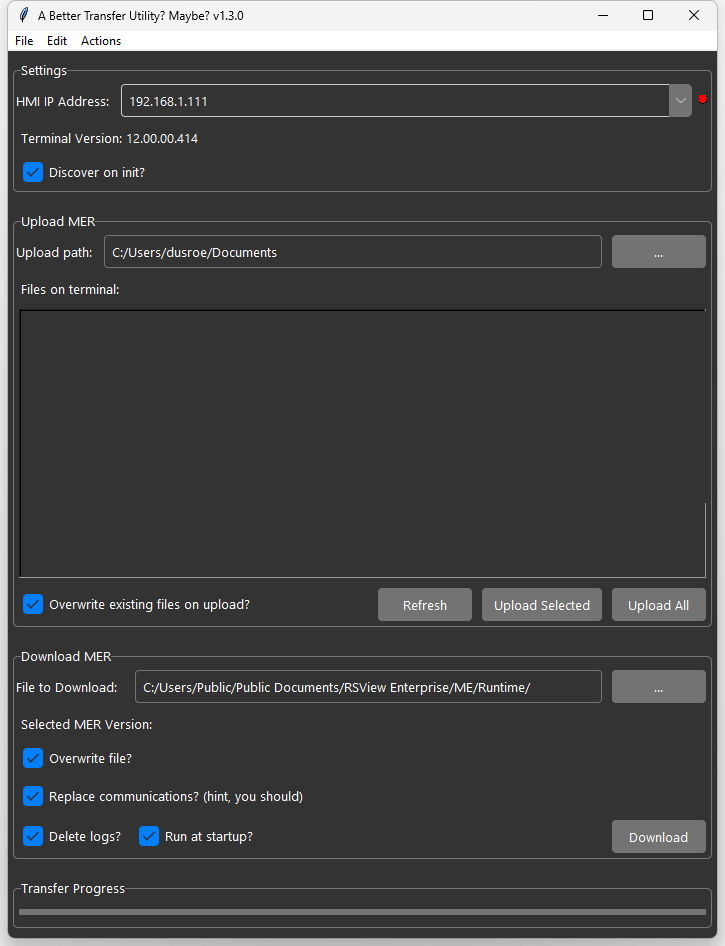

# pymeu_gui
GUI front end for the Python ME Transfer Utility

## Features
* Works indpendent of any Rockwell software
* Discover all PanelView Plus terminals on the network
* Easily select a PanelView by IP address
* Upload one MER or upload all files
* Doesn't have the EDS subsystem, so all you need is the IP address
* Supports backplane path routing
* Verifies MER version is the same or older than terminal firmware
* Alerts if MER is protected
* Delete MER from PanelView

To add an IP address to the IP list, type it into the list box and press Enter. This adds the IP to the list and selects it as the device to connect to.
When connecting to a network over VPN, broadcast packets are blocked, so no devices are discovered automatically. You must enter the PanelView IP addresses manually.

Like Logix, if you need to route through a backplane, enter the IP address of the first device (PLC/CLX rack), followed by the hops in pairs.
Example: routing through a CompactLogix backplane:
`192.168.1.10,4,10.17.224.9`

## Acknowledgements
* **aawilliams85** for the excellent pymeu utility [aawilliams85](https://github.com/aawilliams85)
* **rdbende** for the sweet theme [rdbende](https://github.com/rdbende/Azure-ttk-theme)
